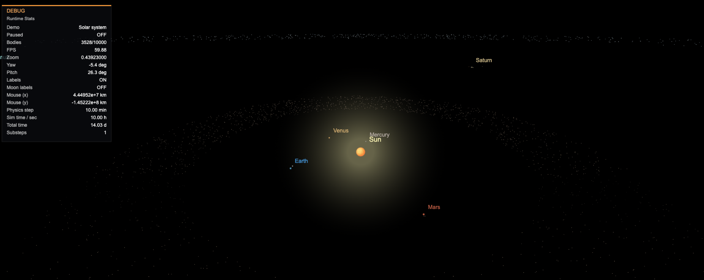

# Orbit simulator

A canvas based application that simulates real orbital mechanics using Verlet integration and the Barnes-Hut algorithm.



## About the engine

The simulation stores bodies in physical units: kilometers, kilograms, and km/s. The built-in Solar System scenario uses real planetary masses, radii, orbit distances, asteroid and Kuiper belts, and named comets, then compresses rendering scale so the whole system remains visible.

Gravity is approximated with a Barnes-Hut octree instead of a full N^2 sweep, with optional SharedArrayBuffer-backed web workers splitting force calculation across bodies if the browser is cross-origin isolated. Motion uses Verlet integration, and the engine also includes simple broad-phase collision checks, impact response, and debris generation.

Rendering is canvas based, but the world is not purely flat: bodies have X/Y/Z positions and velocities, orbits can be tilted or retrograde, and the camera supports yaw, pitch, depth sorting, zoom-to-cursor, and body following. Besides the real Solar System, the app also has scenarios with a triple-star system, procedural systems, and a procedural galaxy with hundreds of generated systems around a supermassive black hole.

# Controls

Both layouts have a control bar at the bottom of the screen with the scenario selector, play/pause, simulation speed and a `⋯` menu with the remaining actions: labels, moon labels, textures, stats panel, black hole (created at the center of the screen), single step, reset scenario and substeps.

## Desktop

The control bar floats at the bottom center, and its buttons show their keyboard shortcut as a tooltip. Press the `?` button in the top right corner to see the full list of shortcuts. The most important ones:

| Input | Action |
| --- | --- |
| `1`-`5` | Select scenario |
| Left click | Select and follow a body |
| Mouse wheel | Zoom |
| Right drag / arrow keys | Rotate camera |
| Middle drag / Cmd drag | Pan camera |
| `Space` | Pan to next planet/star |
| `P` | Pause / resume |
| `+` / `-` | Increase / decrease simulation speed |
| `L` / `M` / `T` / `D` | Toggle labels / moon labels / textures / debug panel |
| `B` / `Shift + B` | Create black hole at mouse / remove black hole |
| `Shift + R` | Reset scenario |

## Mobile

The app adapts automatically to touch devices (phones and tablets):

- The control bar spans the full width of the screen, and "Next planet / star" is in the `⋯` menu.
- The canvas is rendered at the device pixel ratio for sharp output on high density screens, and the HUD panels scale down to fit small screens. The stats panel is hidden by default and can be enabled from the menu.
- Tapping a body follows it and shows its info at the bottom of the screen.
- To keep the simulation smooth on mobile CPUs, scenarios generate fewer bodies on touch devices (asteroid and Kuiper belts use 20% of the desktop amount, the random galaxy has 120 solar systems instead of 500), and at most 2 physics steps run per frame: on a slow device the simulation slows down instead of the app freezing.

| Gesture | Action |
| --- | --- |
| Tap | Select and follow a body |
| Tap on empty space | Stop following |
| One finger drag | Rotate camera |
| Pinch | Zoom |
| Two finger drag | Pan camera |

The `?` button lists the touch controls when opened on a mobile device.

## Choosing the layout

The mobile layout is used when the main input of the device is a touchscreen (CSS `pointer: coarse`), the desktop layout otherwise. The layout can be forced by adding `?layout=desktop` or `?layout=mobile` (or `#desktop` / `#mobile`) to the URL, for example to preview the mobile layout on a computer. The reduced body counts for touch devices always follow the device, not the chosen layout.

# How to run

## Prerequisites

- Node.js installed

## Install dependencies

```
npm install
```

## Run

```
npm start
```

Now open the browser at http://localhost:1234

To try the mobile version during development, either use the device emulation of the browser developer tools, or open `http://<your-computer-ip>:1234` from a phone connected to the same network.

# App demo

A live version of the app (with no web workers support) can be found at this [link](https://samdalvai.github.io/orbit-simulator.js/). It works both on desktop and on mobile devices.
